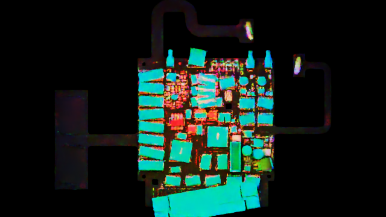

# PCB-AOI Cookbook

One page of copy-paste recipes for the supported ways to use this repo:
**write Python** or **run a CLI command**.
Start here — everything else is one link away.

## Where do I go for what

| You want | Go to |
|---|---|
| Task recipes (you are here) | **COOKBOOK.md** |
| Repo setup, Docker commands, the numbered flows | [README.md](README.md) |
| Declarative Python API (`cdf`) reference | [cdf/API_SPEC.md](cdf/API_SPEC.md) |
| PCB-AOI versioned YAML API guide | [pcb_aoi/config/README.md](pcb_aoi/config/README.md) |
| Full capability matrix (YAML ↔ API ↔ skills) | [cdf/CAPABILITIES.md](cdf/CAPABILITIES.md) |
| Agent skills | [skills/cdf](skills/cdf/SKILL.md) · [skills/cdf-simulate](skills/cdf-simulate/SKILL.md) |
| Crop stage internals | [scripts/crop/README.md](scripts/crop/README.md) |

## Quick reference

| Task | One line | Recipe |
|---|---|---|
| Generate a dataset | Render a full good / defect / missing dataset with labels (authoritative) | [B1](#b1-generate-a-full-dataset) |
| Crop components | Cut per-component patches out of already-rendered frames | [B2](#b2-crop-components-after-a-render) |
| Vary through-hole pins | Tilt, offset, extend, or trim selected pins | [B3](#b3-vary-through-hole-pins) |

Batch pipeline output is authoritative for rendered datasets.

## Prerequisites

**Batch.** Either Docker (canonical — copy a `docker run` line from
[README.md](README.md)) or a host Isaac Sim install:

> **Add a Kit cache mount to every `docker run`.** The first render in a
> container spends about 110 s compiling RTX pipelines and shaders and writes
> the result into `/isaac-sim/kit/cache`; a container that starts without one
> pays it again. Measured on the same job in two fresh containers, keeping the
> cache took a render from **162.9 s to 58.0 s**:
>
> ```bash
> export KIT_CACHE=$HOME/.cache/cdf-kit && mkdir -p "$KIT_CACHE" && chmod 777 "$KIT_CACHE"
> docker run ... -v "$KIT_CACHE":/isaac-sim/kit/cache ...
> ```
>
> `render_batch` is the other startup-cost lever: it runs a whole dataset in
> one process.

```bash
export ISAAC_SIM_PATH=<isaac-install>/isaac-sim.sh   # local (non-Docker) mode
export PCB_USD_PATH=<path-to>/board.usd              # expanded into pcba_target.yaml "scene:"
export PCB_AOI_ROOT=$(pwd)                           # repo root; expanded into flow YAML "output:"
```

---

## Batch recipes

### B1. Generate a full dataset

**Say to an agent** (triggers the `simulation` skill):
> "Generate a defect dataset for the allegro board" · "Make 100 defect images with only tombstone" · "Render missing-component frames"

**Python API** (full runnable version: [pcb_aoi/examples/allegro_defect_job.py](pcb_aoi/examples/allegro_defect_job.py)):

```python
import pcb_aoi                      # registers the "pcb-aoi" domain
from cdf import CDFJob

job = CDFJob(domain="pcb-aoi", random_seed=0)
job.scene.configure(usd_path="<board>.usd", root_path="/Board_<name>",
                    camera_path="/World/camera_light/Camera",
                    camera_xform_path="/World/camera_light",
                    ring_light_root="/World/camera_light/aoi_ring_light")
job.scene.attach_sidecar(name="components", kind="pcb.components",
                         path="<board>.components.json")   # CAD boards need this
job.scene.select_components(source="components")
job.appearance.lighting(mode="rgb_light", layers={...})
job.operations.add_tombstone(ratio=0.2, angle_range=(70, 90))
job.annotations.enable_operation_labels(namespace="defect")
job.capture.renderer(mode="pathtracing", resolution=(1920, 1080),
                     spp=1, total_spp=32, max_bounces=4)
job.capture.camera(rotation_range={"x": (0, 0), "y": (0, 0), "z": -90})
job.capture.scan_grid(x_count=10, y_count=10)
job.capture.outputs(rgb=True, bounding_box_2d_tight=True,
                    semantic_segmentation=True, semantic_types=["defect"])
plan = job.compile_orders(output_dir="sdg_test_output/my_run")  # dry run
result = job.capture.render(output_dir="sdg_test_output/my_run")
```

**Several variants at once.** A dataset is usually one board and several
defect families, and running them one `render()` at a time pays the Isaac boot
per variant. `render_batch` runs them in one process:

```python
from cdf import BatchJob, render_batch

results = render_batch([
    BatchJob(golden_job, output_dir="out/golden"),
    BatchJob(tombstone_job, output_dir="out/tombstone"),
])
for result in results:
    print(result.success, result.total_duration_s)
```

A job that fails does not end the batch — check `result.success` per item
rather than expecting a raise. Measured over three variants, the second and
third cost 8.5 s and 8.8 s instead of 38.0 s and 40.5 s.

**How image counts map to mechanisms.** "Generate 5 defect images" is
ambiguous — N can count four different things, so resolve it before
running (ask ONE multiple-choice question if context doesn't decide):

- **scan-grid patches** — the camera steps across the board in an
  `x_count` × `y_count` grid; images per pass (trigger) = x × y. N=5 →
  `scan_grid: {x_count: 5, y_count: 1}` (or 1×5), or keep a larger grid
  and truncate with `max_image_count: 5`.
- **per-component images** — N different components: render + [B2 crop](#b2-crop-components-after-a-render)
  for labeled patches.
- **N triggers** — N whole-board frames, defects/lighting re-randomized
  each time: `num_triggers: 5`, no grid.
- **multiview** — N viewpoints of the same spot: define multiple camera
  poses or capture passes.

Context hints: grid/tiles/patches → scan grid; "different components" →
per-component; "views"/"angles" → multiview; dataset/labels → triggers or
crops. Always show the concrete params before running.



### B2. Crop components after a render

**Say to an agent** (`cdf` skill): "Generate a Python API script that crops the rendered components in sdg_test_output/my_run."

**Python API:** declare
`job.postprocess.crop(method="bbox_tight", types=["rgb", "semantic_segmentation"], offset=10, min_coverage=0.2)`
before `job.capture.render(...)`. The JobOrder executor runs it after capture.

**UI:** none. See [scripts/crop/README.md](scripts/crop/README.md) for crop
implementation details.

### B3. Vary through-hole pins

**Say to an agent** (`cdf` skill): "Tilt the through-hole pins on the TO92s up
to 15 degrees and trim them to between 0 and 1.5 mm of protrusion."

**Python API:** declare it before `job.capture.render(...)`; the compiler makes
the capture depend on it, so the render sees the varied leads.

```python
job.operations.pin_variation(
    package_types=("TO92",),
    tilt_range=(0, 15),
    height_variation=(0.0, 1.5),
    cut_angle=(0, 60),
).pin_variation(
    components=("C1001", "C1002"),
    tilt_range=(0, 4),
)
```

`components` (refdes) and `package_types` are **mutually exclusive** in one
call — prefer `components` where the board's package metadata is not
dependable. Call it again for another set of parts; a lead named by more than
one group takes the last group that names it.

Every range is a **request**. Tilt competes with the barrel, off-centre with
whatever clearance the tilt left, and the cut angle with the protrusion it has
to fit inside. The order output records the delivered value and which
constraint bound it, per lead, so an unreachable request is visible as a pair
rather than a silent substitution — **a 15 degree tilt is typically not
reachable**, because a rigid pin in a plated barrel runs out at roughly 4 to 12
degrees depending on the hole.

Requires a board that authors `pcb:mesh:role` (`pkg_lead` / `board_hole`) with
`pcb:hole:radiusMm`; the order fails naming what it looked for otherwise.

**Verify:** render the board **bottom-side**. Tilt, protrusion and the cut plane
are all below the far face, and a top-down pass shows none of them.

**Versioned JobConfig YAML:** supported — `operations.pin_variation` takes a
sequence, one mapping per group, with `tilt`, `offset`, `height` and
`cut_angle` bands and the same mutually exclusive `components` /
`package_types` selectors. See
[pcb_aoi/config/README.md](pcb_aoi/config/README.md).

```yaml
operations:
  pin_variation:
    - package_types: [TO92]
      tilt: [0.0, 15.0]
      height: [0.2, 1.4]
      cut_angle: [0.0, 45.0]
```

**Legacy pipeline CLI / flow YAML:** none.

**UI:** none.

---

## Assumptions & defaults

Things the tools assume without telling you. Each row: the default, and where to change it.

| Assumption | Default | Override / source |
|---|---|---|
| Board asset units / up-axis | Board USDs are authored in **mm, Y-up** | Read `UsdGeom.GetStageMetersPerUnit(stage)` instead of assuming. All mm-typed knobs (`translate_range`, fillet offsets) assume mm assets |
| `component_types: ALL` | Resolves against the registry travelling with the board's own pcba target — `component_registry:` in it, else a sibling `components.yaml` (`0` = none; subset keys allowed). There is no repo-wide registry | Inline a list in your `pcba_target.yaml`; CAD boards: attach the `<board>.components.json` sidecar and `select_components(source=...)` |
| API component scope | `select_components()` with neither `types` nor `source` → `ALL` | `cdf/sections.py` |
| Blocks the compiler always emits | `augmentation.motion_blur` present but disabled (`probability: 0.0`) — the pipeline reads it unconditionally — and all four `defects.*` blocks (disabled unless you add the op) | Call `capture.augmentation(...)` / `operations.add_*(...)` |
| `writer.semantic_types` | `[class]` (good flow) vs `[defect]` (after `enable_operation_labels(namespace="defect")`); **must include `defect`** or defect labels never appear | `capture.outputs(semantic_types=[...])` / flow YAML |
| Fillet `PARAMS` | `comp_types` and `pcba_root` are **empty** — no board default; `camera_path=/World/camera_light/Camera`, `adaptive_scale=False`, `adaptive_sz=False`, `pad_aware=False` | Set `comp_types`/`pcba_root` for your board (the batch pipeline raises if the pcba target omits them); for CAD boards set `adaptive_scale=True` + `pad_aware=True` (needs sidecar). `FilletParams` in [scripts/sdg/editor/editor_solder_fillet_board.py](scripts/sdg/editor/editor_solder_fillet_board.py) |
| Fillet inward placement | `inward_offset_mm=2.6` when `adaptive_scale=False`; `inward_frac=0.15` when `True` — mutually exclusive | Same file |
| Crop knobs | `offset=10` px, `min_coverage=0.2`, `xform_depth=7`, types `(rgb, semantic_segmentation, instance_id_segmentation)` | [scripts/crop/crop_defaults.py](scripts/crop/crop_defaults.py); any `crop:` key you set wins |
| Crop algorithm (in-process) | The pipeline `crop:` block is **bbox_tight only**; `crop.types: [rgb]` alone yields nothing — labels/coverage come from a semantic output, so keep a semantic type in `writer` + `crop.types` | Other algorithms: [scripts/crop/README.md](scripts/crop/README.md) |
| Batch env vars | `ISAAC_SIM_PATH` (host launcher), `PCB_AOI_ROOT` (expanded in flow YAML `output:`), `PCB_USD_PATH` (expanded in `pcba_target.yaml` `scene:`) | Export before running; Docker lines pass them with `-e` |

## Troubleshooting

### `omni.replicator.core has no attribute 'create'` on a host Isaac install

Symptom: every order succeeds and `capture.render` dies with

    AttributeError: module 'omni.replicator.core' has no attribute 'create'

which names neither the cause nor anything near it. It looks exactly like the
warp/Replicator init race the standalone shim guards against, and it is not
that -- warp imports fine, and pre-importing it changes nothing.

Cause, isolated on Windows: **the PARENT process.** `job.execute()` spawns the
Isaac child with `subprocess`, and when the parent is a venv built on the
Microsoft Store Python (`C:\Program Files\WindowsApps\PythonSoftwareFoundation
.Python...`), the child inherits a restricted package-identity context and Kit's
extension startup leaves `omni.replicator.core` a namespace placeholder.

Measured, same command and same board each time:

| parent process | child `rep.create` |
|---|---|
| `cmd.exe` | present |
| Isaac's own `python.bat` | present |
| Store-Python venv | **absent** |

It is not the stdio: pipes, a file, an inherited console and
`CREATE_NEW_CONSOLE` all fail from that parent, and the child's environment,
`argv`, `sys.executable` and `sys.path` are byte-identical between a working
and a failing launch. It is not a leftover Kit process either.

Fix: drive `job.execute()` from any Python that is not the Store build ---
Isaac's bundled `python.bat` works, and so does a venv built on a python.org
install. Check yours with:

```python
import sys; print("WindowsApps" in sys.base_prefix)   # True == this parent will fail
```


| Symptom | Fix |
|---|---|
| Crop step produced no images | `crop.types: [rgb]` alone can't work — enable a semantic output in `writer:` and include it in `crop.types` |
| 0 components found on a CAD board | The reference board's `component_types` don't match CAD names — attach `<board>.components.json` and `select_components(source=...)` (or a per-board `pcba_target.yaml`) |
| Tombstone finds no eligible components | Provide `components_json` / `sim_manifest`, or set `defects.tombstone.component_types` explicitly |
